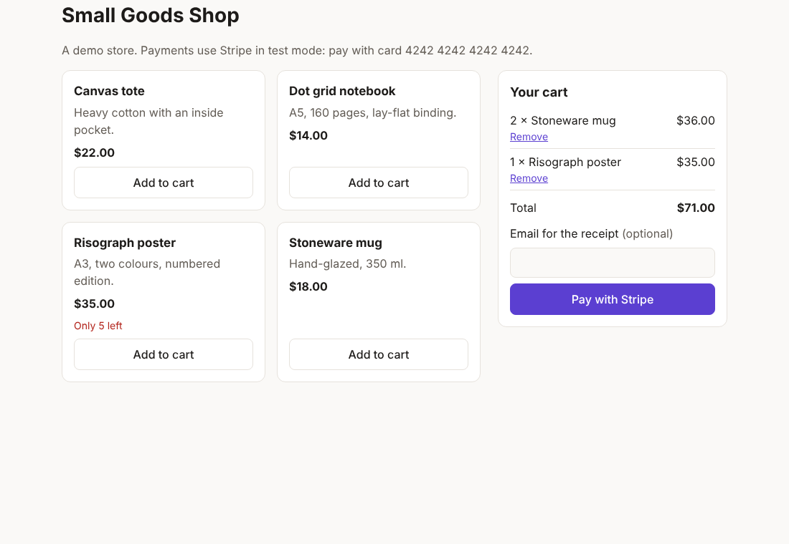

# storefront-payments

[](https://github.com/daen8584-spec/storefront-payments/actions/workflows/ci.yml)

An online store checkout with Stripe: products, stock, payments, refunds and the webhooks that tie them together. It's built for the parts that usually go wrong: messages delivered twice or out of order, two customers buying the last item at once, and crashes halfway through.



## What it does

- Lists products and takes orders through [Stripe Checkout](https://docs.stripe.com/payments/checkout)
- Reserves stock when checkout starts and releases it if the customer doesn't pay
- Marks orders paid only when Stripe confirms it through a signed webhook
- Handles delayed payment methods, expired checkouts and payments that arrive late
- Refunds, full or partial, from an admin endpoint, safe to repeat
- Keeps an audit trail of every order status change

## How a purchase flows

```
Customer             Store                          Stripe
   │ Pay               │                               │
   │──────────────────>│ lock rows, reserve stock,     │
   │                   │ save order (one transaction)  │
   │                   │──── create Checkout Session ─>│  idempotency key: checkout-<order>
   │<── redirect ──────│                               │
   │─────────────────────── pays on Stripe ───────────>│
   │                   │<── checkout.session.completed │  signed webhook, retried until 2xx
   │                   │ verify signature, record      │
   │                   │ event id, mark paid           │
   │<── order page ────│ (polls until paid)            │
```

The design decisions, and the test behind each, are in [docs/decisions.md](docs/decisions.md). In short:

- **The customer never sets the price.** The server computes it, and the webhook checks Stripe's amount against it.
- **No overselling.** Checkouts lock the product rows. Twelve simultaneous checkouts for the last five items sell exactly five.
- **Duplicate webhooks do nothing.** Each Stripe event id is stored in the same transaction that applies it.
- **Out-of-order webhooks can't undo newer states.** For example, a late "expired" can't cancel a paid order.
- **Nothing is charged twice.** Checkout sessions and refunds use idempotency keys.
- **Crashes leave nothing stuck.** Stock held by a checkout that never reached Stripe is released by a sweeper.

## API

| Method | Path | Who | What |
| --- | --- | --- | --- |
| `GET` | `/api/products` | Anyone | Products with price and stock |
| `POST` | `/api/checkout` | Anyone | `{"items":[{"productId":"mug","quantity":2}],"email":"…"}`, returns the Stripe Checkout URL |
| `GET` | `/api/orders/:id` | Anyone with the id | Order status and items |
| `POST` | `/webhooks/stripe` | Stripe | Signed events |
| `GET` | `/api/admin/orders` | Admin | Recent orders |
| `GET` | `/api/admin/orders/:id/events` | Admin | Status history of an order |
| `POST` | `/api/admin/orders/:id/refunds` | Admin | `{"amountCents":500}` or empty for the rest; requires an `Idempotency-Key` header |

Admin requests use `Authorization: Bearer <ADMIN_TOKEN>`.

## Running it

You need Node.js 22 or later, PostgreSQL, and a Stripe account in test mode (free).

```bash
npm install
cp .env.example .env              # add your Stripe test keys and an admin token
createdb storefront
npm run migrate -- --seed         # tables and four demo products
npm run dev
```

To receive webhooks locally, run the [Stripe CLI](https://docs.stripe.com/stripe-cli) in another terminal and put the secret it prints in `STRIPE_WEBHOOK_SECRET`:

```bash
stripe listen --forward-to localhost:3000/webhooks/stripe
```

Open http://localhost:3000 and pay with the test card `4242 4242 4242 4242`. You can replay events with `stripe events resend <id>` and watch them be ignored as duplicates.

With Docker: `docker compose up --build`, with the Stripe keys and `ADMIN_TOKEN` in your environment or a `.env` file.

## Tests

```bash
createdb storefront_test
npm test
```

33 tests run against a real PostgreSQL database and a small fake of the Stripe API. The fake returns the same object for a repeated idempotency key, as Stripe does, and can fail on demand. Webhooks in the tests are signed with the Stripe library's own helper, so signature checking runs for real.

They cover checkout validation and pricing, concurrent checkouts for the last items, Stripe outages, abandoned checkouts, tampered signatures, duplicate and out-of-order events, late and delayed payments, partial and full refunds, and admin access. CI also builds the Docker image and checks the running store.

## Stack

TypeScript on Node.js, [Fastify](https://fastify.dev), PostgreSQL with plain SQL, the official [Stripe library](https://github.com/stripe/stripe-node), Zod for validating requests and webhook payloads, and Vitest. The storefront is plain HTML, CSS and JavaScript.

## License

MIT
